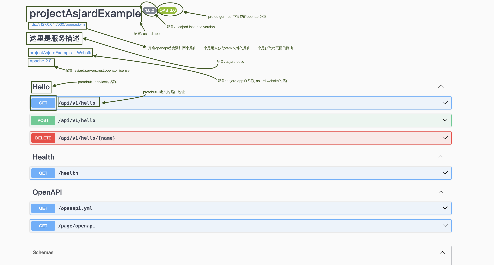

> 可以通过暴露 rest 服务对外提供 HTTP 服务。

REST 服务基于 Go 标准库 [`net/http`](https://pkg.go.dev/net/http)，路由使用 `http.ServeMux`（支持 `GET /api/v1/hello/{name}` 这类 method + path pattern）。`rest.Context` 封装了 `*http.Request` / `http.ResponseWriter`，可通过 `Request()` / `Response()` 访问底层对象。

详细示例参考[这里](https://github.com/asjard/asjard/blob/develop/_examples/svc-example/apis/api/v1/sample.go)

## 配置

```yaml
## 服务相关配置
asjard:
  ## 多协议服务相关配置
  ## 不实时生效，修改后需重新启动
  servers:
    ## rest(HTTP)协议相关配置
    rest:
      ## 同grpc相关配置
      enabled: true
      ## 文档相关配置
      doc:
        ## 错误页地址, 如果错误返回，默认可以解决错误的文档地址
        ## 如果不配置则使用website配置
        # errPage: ${asjard.service.website}
      ## openapi相关配置
      openapi:
        ## 是否开启openapi
        # enabled: false
        ## 文档域名；为空时使用 advertise / listen
        # endpoint: https://example.com
        # page: https://petstore.swagger.io/?url=http://%s/openapi.yml
        # termsOfService: ""
        license:
          # name: "Apache 2.0"
          # url: "http://www.apache.org/licenses/LICENSE-2.0.html"
        scalar:
          # theme: alternate
          # cdn: ""
          # sidebarVisibility: false
          # hideModels: false
          # hideDownloadButton: false
          # darkMode: false
          # hideClients: []
          # authentication: ""
      routes:
        ## 开启后会多一个接口/routes,返回当前服务所有的rest routes
        enabled: true
      ## 国际化是否相关配置
      i18n:
        # enabled: false
      ## 跨域相关配置
      cors:
        # disabled: false
        # allowAllOrigins: false
        # allowOrigins: "*"
        # allowMethods:
        #   - GET
        #   - HEAD
        #   - PUT
        #   - PATCH
        #   - POST
        #   - DELETE
        # allowHeaders:
        #   - Origin
        #   - Content-Length
        #   - Content-Type
        # exposeHeaders: ""
        # allowCredentials: false
        # maxAge: 12h
      ## 同grpc相关配置
      addresses:
        # listen: 127.0.0.1:7030
        # advertise: 127.0.0.1:7030
      ## 对应 net/http.Server 的常用调优项
      ## 参考 https://pkg.go.dev/net/http#Server
      # options:
      #   ## ReadTimeout 是读取完整请求（含 body）的最长耗时。
      #   ## 默认 30s。
      #   readTimeout: !!str 30s

      #   ## ReadHeaderTimeout 是读取请求头的最长耗时。
      #   ## 默认 10s。
      #   readHeaderTimeout: !!str 10s

      #   ## WriteTimeout 是写响应的最长耗时。
      #   ## 默认不限制（0）。
      #   writeTimeout: !!str 0s

      #   ## IdleTimeout 是 keep-alive 下等待下一个请求的最长空闲时间。
      #   ## 默认 60s。
      #   idleTimeout: !!str 60s

      #   ## MaxHeaderBytes 限制请求头最大字节数。
      #   ## 默认使用 net/http 的 DefaultMaxHeaderBytes。
      #   maxHeaderBytes: !!int 0

      #   ## Maximum request body size.
      #   ## 默认 20MB（20971520）。
      #   maxRequestBodySize: !!int 20971520

      #   ## 是否禁用 keep-alive。
      #   ## 为 true 时，服务端在返回第一个响应后关闭连接。
      #   ## 默认 false（启用 keep-alive）。
      #   disableKeepalive: !!bool false
```

### 开启openapi文档

```yaml
asjard:
  servers:
    rest:
      openapi:
        enabled: true
        ## 一个可以展示openapi.yml文件的页面
        page: https://petstore.swagger.io/?url=http://%s/openapi.yml
        termsOfService: ""
        license:
          name: Apache 2.0
          url: http://www.apache.org/licenses/LICENSE-2.0.html
        scalar:
          # theme: alternate
          # cdn: ""
          # sidebarVisibility: false
          # hideModels: false
          # hideDownloadButton: false
          # darkMode: false
          # hideClients: []
          # authentication: ""
```

- 访问`localhost:7030/page/openapi`即将会跳转到`asjard.servers.rest.openapi.page`页面
- 或者访问`localhost:7030/page/scalar/openapi`

- 其中显示信息如下图所示:



### 跨域配置

```yaml
asjard:
  servers:
    rest:
      ## 跨域相关配置
      ## 跨域是自动开启的
      cors:
        allowOrigins:
          - "*"
        allowMethods:
          - GET
          - POST
          - PUT
          - DELETE
          - PATCH
        allowHeaders:
          - Origin
          - Content-Type
          - Content-Length
        allowCredentials: false
        exposeHeaders: []
```

### Context 常用方法

| 方法 | 说明 |
| --- | --- |
| `Request()` / `Response()` | 底层 `*http.Request` / `http.ResponseWriter` |
| `Header` / `Headers` | 读取请求头 |
| `Query` / `Queries` | 读取 query |
| `PathValue` / `PathValues` | 读取 ServeMux path 参数（如 `{name}`） |
| `ReadEntity` | 按 query < header < body < path 绑定到 protobuf |
| `Write` / `WriteData` | 写响应；`WriteData` 走注册的 Writer |
| `SetUserValue` / `GetUserValue` | 请求级自定义值（如 trace id） |

路径参数需使用 protobuf/`protoc-gen-go-rest` 生成的 `{name}` 形式，对应 `net/http` ServeMux wildcard，而不是旧的 `:name`。

## 示例

```go
package apiv1

import (
	"context"

	pb "protos-repo/example/api/v1/sample"

	"github.com/asjard/asjard/pkg/server/grpc"
	"github.com/asjard/asjard/pkg/server/rest"
)

type SampleAPI struct {
	pb.UnimplementedSampleServer
}

func NewSampleAPI() *SampleAPI {
	return &SampleAPI{}
}

func (api *SampleAPI) Start() error { return nil }
func (api *SampleAPI) Stop()        {}

// GRPC服务
func (api *SampleAPI) GrpcServiceDesc() *grpc.ServiceDesc { return &pb.Sample_ServiceDesc }

// HTTP服务
func (api *SampleAPI) RestServiceDesc() *rest.ServiceDesc { return &pb.SampleRestServiceDesc }

func (api *SampleAPI) SayHello(ctx context.Context, in *pb.HelloRequest) (*pb.HelloReply, error) {
	return &pb.HelloReply{
		Message: "hello " + in.Name,
	}, nil
}
```

自定义writer,[protobuf](protobuf.md)中method的option添加`write_name`添加自定义输出

```proto
service Server {
    option (asjard.api.serviceHttp) = {
        group : "examples/server"
    };

    rpc Say(HelloReq) returns (HelloReq) {
        option (asjard.api.http) = {
            delete : "/region/{region_id}/project/{project_id}/user/{user_id}"
            // 此接口自定义输出
            writer_name : "custome_writer"
        };
    };
}
```

代码中添加`writer`以便在加载路由时能找到自定义writer

```go
// Response 自定义rest输出
type Response struct {
	Err  error `json:"err"`
	Data any   `json:"data"`
}

func init() {
	// 添加自定义输出
	rest.AddWriter("custome_writer", CustomeWriter)
}

// CustomeWriter 自定义输出
func CustomeWriter(c *rest.Context, data any, err error) {
	b, err := json.Marshal(&Response{
		Err:  err,
		Data: data,
	})
	if err != nil {
		logger.Error("custome writer fail", "err", err)
	}
	c.Response().Header().Set("Content-Type", "application/json")
	c.Write(b)
}
```
